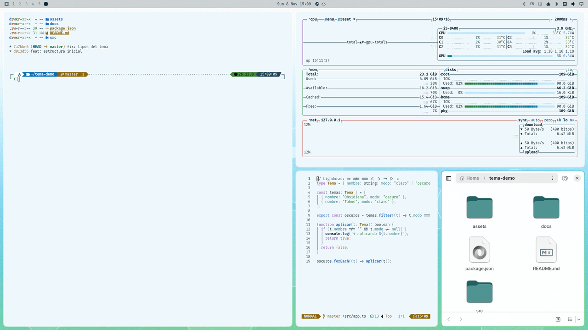

<a href="https://thealejandro.dev"><picture><source media="(prefers-color-scheme: dark)" srcset="docs/marca/logotipo.svg"></picture></a>

# Aero

[Español](README.es.md)

An [Omarchy](https://omarchy.org) theme. Inspired by Windows Vista / 7, light.

Windows Vista and 7 Aero: sky-blue glass, grass green and a glowing blue-to-green border.



## Install

```bash
omarchy theme install https://github.com/thealejandro/omarchy-aero-theme
```

### Rounded corners and prompt colors (recommended)

Omarchy skips `.lua` files in themes installed from a repo, so this theme keeps
its corner radius in `shape.toml`. A small hook from
[omarchy-themes](https://github.com/thealejandro/omarchy-themes) applies it, and another one recolors the
[Tide](https://github.com/IlanCosman/tide) prompt (fish) to match:

```bash
git clone https://github.com/thealejandro/omarchy-themes
omarchy-themes/install.sh
```

Without the hooks the theme still works; windows just keep your default corners.

## What's inside

| File | What it does |
| --- | --- |
| `colors.toml` | The palette. Omarchy builds the terminal, btop, Neovim, VS Code, bar and the rest from it. Accent `#0073b7`, light mode. |
| `icons.theme` | Icon theme: `Yaru-prussiangreen`. |
| `shape.toml` | Corners: 10 px, rounding power 4. |
| `hyprland.lua` | The same border and corners, for when you copy the folder by hand. |
| `backgrounds/` | Three wallpapers, made for this theme. |

Update with `omarchy theme update`; remove with `omarchy theme remove aero`.

More themes: [thealejandro.dev/omarchy](https://thealejandro.dev/omarchy)

Made by [thealejandro](https://thealejandro.dev)

Not affiliated with Apple or Microsoft. [MIT](LICENSE)
